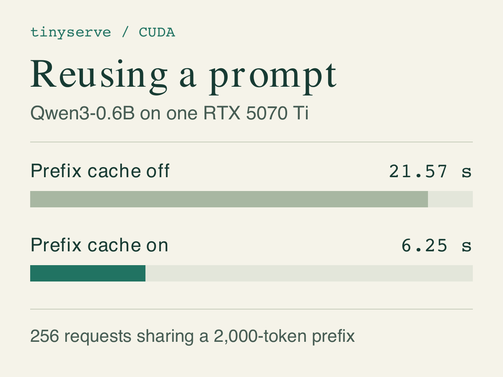

# Full-stack developer

I like questions I can test on one machine. How much work can a GPU skip when prompts repeat? Can a robot arm tell when it has missed a grasp?

  
  

**tinyserve** runs Qwen3 on a single GPU with CUDA kernels I wrote. Reusing the first 2,000 tokens of each prompt cut a 256-request run from 21.57 seconds to 6.25. [Inference engine](https://github.com/OHMFOHS/tinyserve) · [Raw timings](https://github.com/OHMFOHS/tinyserve/blob/master/benchmarks/results/prefix.jsonl)

**Robot arm in MuJoCo.** A depth camera helps the arm check where each object landed. I tested what happens when the gripper slips or aims wide. With recovery switched on, successful sorts went from 4 to 46 across the same 50 simulated layouts. [Simulator and experiments](https://github.com/OHMFOHS/vla-manipulation-sim#11-benchmark-results)

### Beyond the experiments

- **Atlas Backend** powers a Java forum. Redis and Caffeine cache popular threads, and Kafka delivers reply notifications. [Source](https://github.com/OHMFOHS/Atlas-Backend)
- **ProofOps** helps heat-pump installers spot missing or blurry documentation photos while they can still retake them. [Source](https://github.com/OHMFOHS/proofops)
